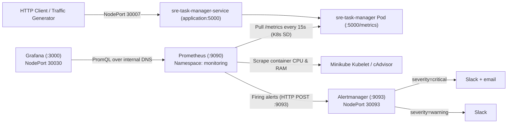

# SRE Observability Stack on Kubernetes (Flask + Prometheus + Grafana + Alertmanager)

A small project that monitors a task manager app running on Kubernetes (Minikube).

- **Flask app:** a simple task manager that exposes metrics.
- **Prometheus:** collects the metrics.
- **Grafana:** shows them on a dashboard.
- **Alertmanager:** sends alerts to Slack and email.
- **CI/CD:** tests, scans and builds the Docker image.

---

## Project Architecture

### Kubernetes & Observability Flow

The cluster has two namespaces: `application` (the app) and `monitoring` (Prometheus, Grafana, Alertmanager).



### Key Ideas
- **Prometheus finds the app pods by itself** (read-only access set in `kube/prometheus/rbac.yaml`).
- **Config is stored in `ConfigMap`s**, and data is stored on `PersistentVolumeClaim`s, so nothing is lost when a pod restarts.
- **Critical alerts** go to Slack and email. **Warnings** go to Slack only.
- **No secrets in Git:** `deploy.sh` and Ansible create them from environment variables.
- **The container runs as a non-root user.**

---

## Repository Structure

```text
sre_academy_project_daniel_barrientos/
├── .github/workflows/ci-cd.yml        # CI/CD: lint, tests, security scan, arm64 image build
├── .gitignore                         # Ignores virtual environments, caches and secrets
├── deploy.sh                          # One-command, idempotent deployment to Minikube
├── deploy_all.sh                      # End to end: Colima, Minikube, deploy.sh, SSH NodePort tunnel, verification
├── deployment_steps.html              # Step-by-step deployment guide (open in a browser)
├── ansible/
│   ├── inventory.ini                  # Local Ansible inventory (127.0.0.1)
│   └── playbook.yaml                  # IaC deployment playbook (tagged per component)
├── App/
│   ├── app.py                         # Instrumented Flask application (/metrics + task API)
│   ├── Dockerfile                     # Container image (Python 3.10 Alpine, non-root, port 5000)
│   ├── requirements.txt               # Runtime dependencies (Flask, prometheus-client)
│   ├── requirements-dev.txt           # Test, lint and security tooling
│   ├── pytest.ini
│   ├── templates/index.html           # Web UI
│   ├── static/                        # UI CSS and JavaScript
│   └── tests/test_app.py              # Unit tests
├── kube/
│   ├── namespaces.yaml                # 'application' (restricted PSA) and 'monitoring'
│   ├── app/                           # configmap, deployment, service (NodePort 30007)
│   ├── prometheus/                    # rbac, configmap, rules-configmap, pvc, deployment, service (30090)
│   ├── alertmanager/                  # configmap, deployment, service (30093)
│   └── grafana/                       # datasource + dashboard configmaps, pvc, deployment, service (30030)
└── scripts/
    └── generate_traffic.py            # Dependency-free traffic generator and alert simulator
```

---

## Prerequisites

- **Container Runtime:** **Docker** (or Colima on macOS)
- **Minikube** (local Kubernetes cluster)
- **kubectl** (configured to point to the Minikube context)
- **Ansible** (optional, for the IaC deployment)
- **Python 3.10+** (optional, for local development and `scripts/generate_traffic.py`)

---

## Deployment Steps

> A step-by-step visual guide is available in [`deployment_steps.html`](deployment_steps.html) (open it in your browser). It also documents [`deploy_all.sh`](deploy_all.sh).

### 1. Start the Local Cluster
```bash
minikube start --driver=docker
```

### Option A: Automated Deployment with `deploy.sh`
Builds the image, loads it into Minikube, creates the secrets, applies every manifest and waits for all rollouts:
```bash
./deploy.sh                # build the image from ./App and deploy
./deploy.sh image.tar      # or load an image archive produced by CI
```

Optional environment variables (never commit real values):

| Variable | Purpose |
| :--- | :--- |
| `SLACK_WEBHOOK_URL` | Slack incoming webhook used by Alertmanager |
| `SMTP_PASSWORD` | SMTP / app password used by Alertmanager for email |
| `RESET=true` | Delete the project namespaces first (clean slate) |

### Option A2: Full Automation with `deploy_all.sh` (macOS)
Runs every step of [`deployment_steps.html`](deployment_steps.html): starts Colima and Minikube if needed, runs `deploy.sh`, opens the SSH tunnel so the NodePorts are reachable on `127.0.0.1`, and verifies all endpoints. It is idempotent, so it is safe to re-run:
```bash
./deploy_all.sh /path/to/image.tar
```
It accepts the same `SLACK_WEBHOOK_URL`, `SMTP_PASSWORD` and `RESET` variables as `deploy.sh`, plus `COLIMA_CPU` and `COLIMA_MEMORY` (defaults 4 and 6) for when Colima has to be started.

### Option B: Automated Deployment with Ansible (IaC)
```bash
ansible-playbook -i ansible/inventory.ini ansible/playbook.yaml
```
*(Re-apply a single tier with tags, e.g. `--tags grafana` or `--tags prometheus,alertmanager`. Use `-e image=<name>` to choose the app image.)*

#### What the Ansible files do

The [`ansible/`](ansible/) folder is the *Infrastructure as Code* alternative to `deploy.sh`. It is **run manually** from the repository root (it is not called by `deploy.sh` or by the CI/CD pipeline) and talks to the cluster through the local `kubectl` context (Minikube).

| File | Purpose |
| :--- | :--- |
| [`ansible/inventory.ini`](ansible/inventory.ini) | Defines the `allhosts` group with a single host, `127.0.0.1`, using `ansible_connection=local`. No SSH: the playbook runs on your own machine. |
| [`ansible/playbook.yaml`](ansible/playbook.yaml) | Declarative, tagged sequence of steps that deploys the whole stack with `kubectl`. |

Playbook flow (top to bottom):

1. **Verify the cluster** (`kubectl cluster-info`) and **create the namespaces** from `kube/namespaces.yaml` (always run).
2. **Create the secrets** from environment variables: `alertmanager-secrets` (`SLACK_WEBHOOK_URL`, `SMTP_PASSWORD`; placeholders are used if unset) and `grafana-admin` (random 20-character password, kept if it already exists). Task output is hidden with `no_log` so secrets never appear in logs.
3. **Apply the manifests** per component: `kube/prometheus/`, `kube/alertmanager/`, `kube/grafana/` and `kube/app/`. The application manifest contains a placeholder image that is replaced with the `image` variable (default `sre-task-manager:1.0.0`) before applying.
4. **Wait for the rollouts** of the Prometheus, Alertmanager, Grafana and `sre-task-manager` deployments (180 s timeout each).
5. **Print pods and services** (`kubectl get pods,svc -A`) when run without tags or with `--tags verify`.

Tags let you re-apply only one tier: `prometheus`, `alertmanager`, `grafana`, `app` and `verify`. Steps tagged `always` (cluster check, namespaces, rollout wait) run with any tag selection.

Prerequisites: Minikube is running and the app image is already loaded into it (run `./deploy.sh` once, or load your own image and pass `-e image=<name>`).

```bash
export SLACK_WEBHOOK_URL="https://hooks.slack.com/services/..."   # optional
export SMTP_PASSWORD="..."                                         # optional

ansible-playbook -i ansible/inventory.ini ansible/playbook.yaml                              # full stack
ansible-playbook -i ansible/inventory.ini ansible/playbook.yaml --tags prometheus,grafana    # only these tiers
ansible-playbook -i ansible/inventory.ini ansible/playbook.yaml -e image=sre-task-manager:1.0.0
```

### Option C: Manual Deployment Steps (`kubectl`)
```bash
kubectl apply -f kube/namespaces.yaml
kubectl apply -f kube/prometheus/
kubectl apply -f kube/alertmanager/
kubectl apply -f kube/grafana/
kubectl apply -f kube/app/      # set the image first: kube/app/deployment.yaml has a placeholder
```
The Alertmanager secrets (`alertmanager-secrets`) and the Grafana secret (`grafana-admin`) must exist in the `monitoring` namespace first; `deploy.sh` creates them for you.

### 2. Verify Pods and Access Web UIs
```bash
kubectl get pods,svc -n application
kubectl get pods,svc -n monitoring
```

With the Docker driver on macOS, expose each service through a local tunnel (keep the terminal open):
```bash
minikube service sre-task-manager-service -n application --url
minikube service prometheus-service -n monitoring --url
minikube service grafana-service -n monitoring --url
minikube service alertmanager -n monitoring --url
```

| Service | Namespace | Internal Cluster DNS | NodePort | Credentials |
| :--- | :--- | :--- | :--- | :--- |
| `sre-task-manager-service` | `application` | `sre-task-manager-service.application.svc.cluster.local:5000` | `30007` | None |
| `prometheus-service` | `monitoring` | `prometheus-service.monitoring.svc.cluster.local:9090` | `30090` | None |
| `grafana-service` | `monitoring` | `grafana-service.monitoring.svc.cluster.local:3000` | `30030` | `admin` / generated (see below) |
| `alertmanager` | `monitoring` | `alertmanager.monitoring.svc.cluster.local:9093` | `30093` | None |

Read the generated Grafana password:
```bash
kubectl -n monitoring get secret grafana-admin -o jsonpath='{.data.admin-password}' | base64 --decode; echo
```

---

## App Endpoints

| Path | What it does |
| :--- | :--- |
| `GET /` | Web page |
| `GET /api/tasks` | List tasks |
| `POST /api/tasks` | Create a task |
| `PUT /api/tasks/<id>` | Update a task |
| `DELETE /api/tasks/<id>` | Delete a task |
| `GET /healthz`, `GET /readyz` | Health checks |
| `GET /metrics` | Metrics for Prometheus |
| `GET/POST /api/chaos` | Inject fake errors/delay (needs `ENABLE_CHAOS=true`) |

Main metrics: `http_requests_total`, `http_request_duration_seconds`, `http_requests_in_progress`, `tasks_current` and `task_operations_total`.

---

## Grafana Dashboard

Grafana loads the **SRE Task Manager - Golden Signals** dashboard automatically. It shows the 4 Golden Signals: **latency**, **traffic**, **errors** and **saturation** (CPU, memory, restarts), plus task counts and firing alerts.

---

## Alerts

| Alert | Severity | Fires when | Sent to |
| :--- | :--- | :--- | :--- |
| `TaskManagerDown` | critical | the app is down for 1m | Slack + email |
| `HighErrorRate` | critical | more than 5% of requests fail (5xx) | Slack + email |
| `HighResponseLatency` | warning | p95 latency is above 500ms | Slack |

Rules: [kube/prometheus/rules-configmap.yaml](kube/prometheus/rules-configmap.yaml). Routing: [kube/alertmanager/configmap.yaml](kube/alertmanager/configmap.yaml).

---

## Testing

Use [scripts/generate_traffic.py](scripts/generate_traffic.py) to create traffic and trigger alerts:

```bash
python3 scripts/generate_traffic.py --help                                  # all options
python3 scripts/generate_traffic.py --url <APP_URL> --mode normal --duration 60    # normal traffic
python3 scripts/generate_traffic.py --url <APP_URL> --mode errors --duration 150   # HighErrorRate
python3 scripts/generate_traffic.py --url <APP_URL> --mode latency --duration 150  # HighResponseLatency
python3 scripts/generate_traffic.py --mode down --duration 90                      # TaskManagerDown
```

Run the app and unit tests locally:
```bash
cd App
python3 -m venv .venv && source .venv/bin/activate
pip install -r requirements-dev.txt
python app.py                                   # http://127.0.0.1:5000
pytest --cov=app --cov-fail-under=90            # tests
flake8 . --max-line-length=100                  # lint
```

---

## CI/CD Pipeline

[`.github/workflows/ci-cd.yml`](.github/workflows/ci-cd.yml) runs on pushes to `main` and `develop` and on pull requests to `main`:

1. **Lint and test:** `flake8` and `pytest` (90% coverage minimum).
2. **Security scan:** `bandit` and `safety`.
3. **Build image:** on `main` only, builds an `arm64` image you can use with `./deploy.sh <image.tar>`.

---


